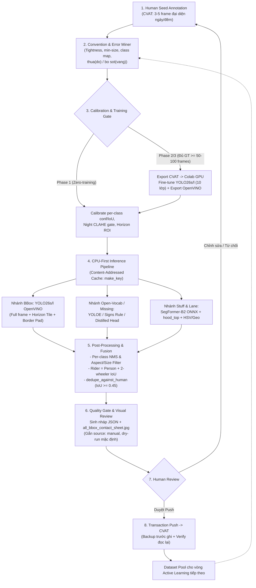

# Kiến trúc Model & Triển khai — CVAT-Learning All-BBox Tool

> **Mục tiêu:** Thiết kế kiến trúc **Model & Deployment** thực chiến theo triết lý **CPU-first**, tối ưu cho máy trạm không GPU (**Intel i7-8850H 6C/12T AVX2, 15.8 GB RAM**), xử lý dữ liệu **dashcam 1280×720 (~65% frame đêm/thiếu sáng)**, bao phủ **10 lớp object bbox + stuff/lane polygons**, và vận hành khép kín theo vòng lặp **CVAT Active Learning**.

---

## 1. Bối cảnh, Ràng buộc Phần cứng & Quy chuẩn An toàn CVAT

| Hạng mục | Thông số / Ràng buộc thực tế | Hệ quả kiến trúc |
|---|---|---|
| **CPU & RAM Inference** | Intel i7-8850H (6C/12T, AVX2, không AVX512), 15.8 GB RAM, **không GPU** | Chạy **tuần tự từng model** (sequential lazy-load + unload), giới hạn `threads: 4–6`, `workers: 1`, peak RAM < 3.5–6.0 GB/phase; ưu tiên **OpenVINO (FP16/INT8)** và **ONNX Runtime**. |
| **GPU Training (Tùy chọn)** | Cloud / Google Colab GPU (ngoài máy local) | Không fine-tune trên i7-8850H. Local chỉ chạy inference, calibration ngưỡng, và mining hard-negative; training YOLO26/SegFormer đẩy lên Colab rồi export OpenVINO/ONNX về local. |
| **Dữ liệu đầu vào** | Dashcam 1280×720, **~65% đêm/thiếu sáng** (job 285: 13/20 frame đêm) | Cần nhánh tiền xử lý thích nghi ngày/đêm (CLAHE/gamma có cổng kiểm soát), ROI/tiling cho vùng chân trời (horizon), và xử lý lóa đèn pha. |
| **Không gian nhãn** | **10 lớp bbox** (`car`, `truck`, `bus`, `train`, `motorcycle`, `bicycle`, `pedestrian`, `rider`, `traffic light`, `traffic sign`) + **stuff/lane polygons** (`road`, `sidewalk`, `building`, `vegetation`, `sky`, `pole`, `wall`, `fence`, `terrain`, `lane/*`, `area/*`) | Không có 1 model đơn lẻ nào phủ đủ 31 nhãn. Phải dùng **Ensemble phân tầng** (Detector + Semantic Seg + Open-Vocab/Rule) + hợp nhất quy ước. |
| **Quy chuẩn CVAT** | `source: manual`, dry-run mặc định, backup trước ghi, **không xóa/sửa shape người dùng** (`dedupe_against_human`) | Mọi nháp lưu file trung gian + sinh `all_bbox_contact_sheet.jpg` để người dùng duyệt trước khi push lên CVAT. |

---

## 2. Luồng Kiến trúc End-to-End: CVAT Active Learning & Inference Pipeline

### Nguyên tắc vận hành cốt lõi của Pipeline
1. **Cache khóa nội dung (`make_key`):** Theo `docs/ARCHITECTURE.md`, mọi kết quả inference đều cache theo `(source_id, frame_range, ckpt_sha256, backend, imgsz, conf, iou)`. Đổi ngưỡng calibration không cần chạy lại backbone nếu lưu raw detections (`conf >= 0.10`).
2. **Tách biệt Detector và Tracker/Post-processor:** Với job rời rạc (`continuity: none` như job 285), mỗi frame suy luận độc lập; với video liên tục, dùng `TrackTrack` + `keyframes.py` để giảm ~80% số keyframe cần duyệt.
3. **Bảo toàn công sức con người (`dedupe_against_human`):** Shape AI không bao giờ ghi đè hoặc xóa shape người dùng đã vẽ; các box trùng khớp với GT người dùng (`IoU >= 0.45` hoặc tâm nằm trong box người dùng cùng nhóm lớp) bị loại bỏ trước khi xuất nháp.

---

## 3. Ma trận Lựa chọn Model (Model Selection Matrix)

### 3.1. Bảng so sánh & Định vị vai trò trên CPU i7-8850H (16 GB RAM)

| Nhóm nhãn | Ứng viên Model | Backend / Format | Tốc độ CPU (ước lượng / đã đo) | Peak RAM | Độ phủ nhãn & Điểm mạnh | Hạn chế & Rủi ro | Quyết định kiến trúc |
|---|---|---|---|---|---|---|---|
| **8 lớp BBox COCO** (`car`, `truck`, `bus`, `train`, `motorcycle`, `bicycle`, `pedestrian`, `traffic light`) | **YOLO26s** | OpenVINO FP16 (`imgsz=640/960`) | **~0.15s/frame** @640 (6.5 FPS e2e đã đo) | ~843 MB | Nhanh, ổn định, đã smoke test OpenVINO & FP16 (`config/models.yaml`). | Bỏ sót xe nhỏ ở chân trời @640; nhầm SUV/van với truck. | **Default Fast/Balanced** cho frame dễ & pass 1 quét toàn cục. |
| **8 lớp BBox COCO** (chính xác cao) | **YOLO26l** | OpenVINO FP16 / INT8 (`imgsz=1280` hoặc **Tile/Horizon ROI**) | PyTorch @1920: 2.62s/f; **OpenVINO FP16 @1280: ~0.6–0.9s/f** [S]; Tiled ROI: ~0.4–0.6s/f | ~1.2–1.8 GB | Recall cao hơn hẳn cho xe xa, đèn giao thông, người nhỏ. | PyTorch @1920 quá chậm (2.62s); **OpenVINO INT8 đang BLOCKED** vì thiếu tập calibration đại diện (đặc biệt ảnh đêm) -> dễ rớt recall người/xe nhỏ. | **Primary BBox Detector (Phase 1+)** chạy OpenVINO FP16; chỉ bật INT8 sau khi có tập calibration >= 100 frame ngày/đêm. |
| **Stuff Polygons** (`road`, `sidewalk`, `building`, `vegetation`, `sky`, `pole`, `wall`, `fence`, `terrain`) | **SegFormer-B2 Cityscapes** | ONNX Runtime (`1024×1024`) | **2.8s/frame** (đã đo trên i7-8850H) | ~1.0–1.5 GB | Nhẹ (~27M params), đạt IoU TB **0.728** (cao nhất trong bài đo `scene_eval_job987.json`), `sky` 0.976, `vegetation` 0.882. | Kém ở frame đêm sâu (mảng rác); thiếu `curb` và `lane marking`. | **Primary Stuff Model** trên CPU. Không dùng SegFormer-B5 (15–21s/f) hay Mask2Former Swin-L (220M, thiếu `swin.layernorm`). |
| **Open-Vocab `traffic sign`** (COCO thiếu, recall hiện tại 0/18) | **YOLOE** (Promptable Open-Vocab) vs **GroundingDINO** | YOLOE (PyTorch/ONNX) / GroundingDINO (PyTorch) | YOLOE-s: **~0.3–0.6s/f** [S]; GroundingDINO-T: **~8–20s/f** CPU [S] | YOLOE: ~1 GB; GDINO: ~2.5 GB | Phát hiện `traffic sign` (biển báo mọi màu/dạng) không cần train lại từ đầu. | GroundingDINO quá nặng để chạy mọi frame trên CPU 16GB; dễ sinh false positive trên bảng quảng cáo. | **Phase 1:** Dùng **YOLOE** (hoặc GroundingDINO chạy **crop/ROI nửa trên frame** ở batch offline) + `signs.py`. **Phase 2:** Distill nhãn vào **YOLO26s-10class**. |
| **Lane & Area** (`lane/*`, `area/direct`, `area/alternative`) | **Mapillary Vistas M2F/OneFormer** (offline) vs **HSV/Geo (`lanes.py`) + Bán tự động** | PyTorch (offline) / OpenCV (local CPU) | Vistas Swin-L: **10–30s/f** CPU [S]; OpenCV/Geo: **<0.05s/f** | Vistas: ~2.5–3 GB | Vistas có `Curb`, `Crosswalk`, `Lane Marking`; nhưng **không** phân biệt trắng/vàng hay đơn/đôi. | Chạy Vistas mọi frame trên CPU vượt ngân sách 10s/frame; rule HSV thuần bị nhiễu nặng ở frame đêm (job 285 f63). | **Phase 1:** Hybrid — giữ `road` tay làm mask giới hạn ROI, dùng `lane_area_from_road.py` + ngưỡng sáng/đêm tách biệt; **Crosswalk/Curb** dùng chấm điểm bán tự động hoặc Vistas chỉ chạy trên frame có `road` phức tạp. |

> **Lưu ý về OpenVINO INT8 vs FP16:** Trong `config/models.yaml`, `openvino_int8` hiện đang ở trạng thái **BLOCKED** vì chưa có tập calibration đại diện (đặc biệt 65% ảnh đêm + vật thể nhỏ). Do đó, **Phase 1 bắt buộc dùng OpenVINO FP16** (an toàn độ chính xác, nhanh hơn PyTorch 2.5–4×). Chỉ mở khóa **INT8 PTQ/QAT** ở Phase 2 khi đã có >= 100 frame GT từ CVAT để kiểm chứng drop recall < 1%.

---

## 4. Ánh xạ Lỗi Thực tế → Giải pháp Kỹ thuật (`xe_contact_sheet.jpg` & `gap_report.md`)

Quan sát trực tiếp trên `data/jobs/285/previews/cars/xe_contact_sheet.jpg` và số liệu `gap_report.md` cho thấy 5 nhóm lỗi chính cần giải quyết triệt để:

| Lỗi quan sát được | Bằng chứng cụ thể (Job 285) | Nguyên nhân gốc rễ | Giải pháp kỹ thuật đề xuất |
|---|---|---|---|
| **1. Ảnh đêm / thiếu sáng & lóa đèn pha** | `f60, f62, f64, f67, f68, f72, f75, f76`: Xe tối màu đỗ ven đường bị bỏ sót (`bo sot(vang)`), hoặc đèn hậu/phản quang ở rìa xa bị nhận nhầm thành xe (`thua(do)` ở f64). | Tương phản cục bộ thấp ở vùng tối; model COCO pretrain thiên về ban ngày; global CLAHE làm cháy vùng đèn pha và tăng nhiễu hạt ở nền trời/đường. | 1. **Dual-exposure / Masked CLAHE:** Chỉ áp dụng CLAHE (`clipLimit=2.0, tileGrid=8x8`) + Gamma (`1.3–1.5`) khi `mean_luma < 75` hoặc `p10_luma < 25` **và mask bỏ vùng đèn lóa** (`V > 240`). 2. **Score Fusion:** Chạy detector trên ảnh gốc + ảnh night-enhanced (hoặc chỉ trên crop nửa dưới) và hợp nhất bằng WBF (Weighted Boxes Fusion). 3. **Phase 2:** Fine-tune với **night/low-light augmentation** (HSV-V, random glare, motion blur). |
| **2. Cắt cụt ở rìa khung hình (Edge-truncation)** | `f61` (van trắng mép phải), `f67` & `f68` (xe đen mép phải `bo sot(vang)`), `f73` (sedan mép phải), `f77` (xe mép phải sau tấm nhựa). | Vật thể bị cắt >40% diện tích bởi biên ảnh mất đặc trưng hình học toàn xe; khi resize letterbox về 640px, phần rìa chỉ còn vài chục pixel. | 1. **Border Reflect/Pad Inference:** Pad thêm 64–96px (màu đen hoặc mirror nhẹ) ở 2 cạnh trái/phải khi suy luận giúp anchor ngoài biên không bị clip sớm, sau đó clamp box về `[0, W]`. 2. **Hạ `conf` theo vùng biên:** Cho phép `conf_border = conf_base - 0.08` cho box chạm `x1 <= 5` hoặc `x2 >= W - 5` nếu `height >= 45px`, gắn cờ `truncated=True` tự động. |
| **3. Xe nhỏ ở đường chân trời (Tiny horizon cars)** | `f60, f67, f68, f72, f76`: Hàng loạt xe ở xa gần điểm tụ bị bỏ sót (`bo sot(vang)`), trong khi `traffic light` chỉ đạt recall 10/36 (28%). | Downsample 1280×720 → 640×360 làm xe ở chân trời chỉ còn 6×6 đến 12×12 px, lọt khỏi feature map P3 của YOLO. | **Horizon-Strip Tiling (không cần tile toàn ảnh 4×4 tốn CPU):** Chỉ cắt **1–2 dải ROI ngang vùng chân trời** (`y = [0.25H .. 0.65H]`, `1280×288` hoặc chia 2 tile `640×320` overlap 20%) chạy ở scale 1:1 (`imgsz=640`). Chi phí chỉ tăng **+1 lần forward** (~0.15s với 26s) thay vì +4–6 lần như SAHI toàn ảnh, nhưng giữ nguyên độ phân giải gốc cho xe xa và đèn giao thông! |
| **4. Nhầm lẫn SUV / Van / Box-truck giữa `car` và `truck`** | `f61` (Range Rover SUV + box truck), `f71` (box truck/SUV), `f74` (van trắng `thua(do)`), `f77` (xe giao hàng). | Quy ước COCO tách `car` / `truck` khác với quy ước gán nhãn của dự án (ví dụ: SUV/minivan là `car`, pickup/box-truck/delivery van là `truck`); xe bị che khuất một phần dễ nhảy lớp. | 1. **Class-agnostic NMS + Margin Rule:** Không chạy NMS riêng từng lớp giữa `{car, truck, bus}`; dùng `agnostic_nms=True` hoặc merge cặp `IoU >= 0.70` thuộc cùng siêu-nhóm `vehicle_4w`. 2. **Active Learning Convention Mining:** Thu thập các cặp bất đồng `car` vs `truck` từ 5–10 frame người dùng sửa, học rule ngưỡng `aspect_ratio` + `area` hoặc train **lightweight crop classifier** (MobileNetV3-Small ONNX, <5ms/box) để phân biệt SUV vs Van/Truck theo đúng gu người dùng. |
| **5. Thiếu `traffic sign` & Recall thấp `traffic light`** | `gap_report.md`: `traffic sign` recall **0/18** (COCO không có lớp biển báo); `traffic light` recall **10/36 (28%)**. | COCO-80 không có `traffic sign`. Đèn giao thông ban đêm nhỏ và lẫn với đèn đường/đèn xe. | 1. **Phase 1:** Chạy **YOLOE** (prompt: `"traffic sign, street sign, speed limit sign"`) hoặc **GroundingDINO** **chỉ trên Upper-Half ROI** (`y = [0 .. 0.60H]`) kết hợp `signs.py` (biển cấm đỏ) để đề xuất box `traffic sign` với `conf >= 0.25`. 2. **Phase 2:** Gộp nhãn `traffic sign` từ CVAT + Mapillary/BDD100K/LISA vào tập fine-tune **YOLO26s-10class** -> loại bỏ hoàn toàn bước Open-Vocab chậm ở Phase 2. |

### Bổ sung cho nhánh Stuff & Lane (từ `TASK_chuyen_gia.md`)
- **Cắt capo (`hood_top`):** Thay vì quy hoạch động thuần ảnh (trượt 4/5 frame), **cố định đường bao capo theo từng camera/job** từ 1–2 frame `road` đầu tiên người dùng vẽ (vì camera dashcam gắn cố định trên kính lái, capo gần như bất biến theo `y`), kết hợp kiểm tra biên dưới mask `road` tay.
- **Làn đường & `area/direct`:** Khi xe trước che khuất làn, dùng điểm tụ toàn cục (median vanishing point của job) + neo độ rộng làn chuẩn tại đáy ảnh (`[0.30W .. 0.70W]` tối đa) thay vì mở rộng nêm 50–55%.

---

## 5. Lộ trình Triển khai 3 Giai đoạn (Deployment Phases)

### Phase 1: Zero-Training Calibrated Ensemble trên CPU (Triển khai ngay)
- **Mục tiêu:** Đạt tốc độ **~3–5s/frame** (trong ngân sách 10s/frame trên i7-8850H, peak RAM < 3.5 GB), kéo recall `car` từ 62% lên >82%, có nháp `traffic sign` và giữ `dedupe_against_human` an toàn 100%.
- **Cấu hình thực thi tuần tự (Sequential Execution):**
  1. **Step 1 (BBox):** `YOLO26s/l` **OpenVINO FP16** chạy 2 pass: Full frame (`imgsz=960`) + Horizon-Strip Tile (`y=[0.25H..0.65H]`, `imgsz=640`). Nếu frame tối (`mean_luma < 75`), chạy thêm pass night-enhanced có mask chống lóa.
  2. **Step 2 (Traffic Sign):** `YOLOE` (hoặc `signs.py` + Upper-Half ROI) chỉ quét nửa trên ảnh (`y=[0..0.60H]`), giải phóng RAM sau khi xong.
  3. **Step 3 (Stuff/Lane):** `SegFormer-B2` **ONNX** (`1024×1024`, ~2.8s/frame) sinh polygon nền (`road`, `sky`, `building`, `vegetation`, `sidewalk`, `pole`) + `hood_top` lock theo job.
  4. **Step 4 (Merge & Review):** `dedupe_against_human` -> gắn `source: manual` -> xuất `all_bbox_contact_sheet.jpg` (hiển thị đủ 10 lớp bbox + stuff/lane, phân biệt rõ AI draft vs Human GT) -> người dùng duyệt mới push CVAT.

### Phase 2: Self-Trained YOLO26s/l (10 lớp) từ CVAT Exports (Colab GPU -> Local OpenVINO)
- **Điều kiện kích hoạt:** Tích lũy được **>= 80–150 frame** đã duyệt trên CVAT (ưu tiên 65% ảnh đêm + đủ mẫu `truck`, `motorcycle`, `traffic light`, `traffic sign`).
- **Quy trình:**
  1. **Export & Hard-Negative Mining:** Trích xuất GT từ CVAT + thu thập các frame có nhiều `thua(do)` (FP phản quang đêm) làm hard-negative background.
  2. **Fine-tune trên Colab GPU:** Huấn luyện **YOLO26s** (cho tốc độ) và **YOLO26l** (cho quality profile) trên đúng **10 lớp chuẩn của dự án** (thêm `traffic sign` và `rider` trực tiếp, chuẩn hóa `car` vs `truck` theo gu người dùng). Bật augmentation chuyên biệt cho dashcam đêm (gamma, blur, cutout, mosaic).
  3. **Export & Calibration:** Export sang **OpenVINO FP16** (mặc định) và chạy **OpenVINO INT8 PTQ** dùng 100 frame ngày/đêm làm calibration set. Chỉ promote INT8 vào `config/models.yaml` nếu `mAP50` và `recall_tiny_night` giảm **< 1.0%**.
  4. **Thay thế Open-Vocab:** Khi YOLO26s-10class đạt `traffic sign` recall >= 75%, **tắt nhánh YOLOE/GroundingDINO** ở Phase 1 để giảm thời gian xử lý mỗi frame xuống **< 1.5s** cho toàn bộ BBox.

### Phase 3: Continuous CVAT Feedback Loop (Vòng lặp học chủ động khép kín)
- **Mục tiêu:** Tự động hóa việc phát hiện điểm yếu của model theo từng job mới và cải tiến liên tục không làm gián đoạn công việc gán nhãn.
- **Cơ chế vận hành:**
  1. **Active Sampling (Chọn frame đáng giá để người dùng sửa trước):** Trước khi nháp toàn job, tool chấm điểm độ bất định (nhiều box `conf` trong khoảng `[0.20, 0.45]`, ảnh tối sâu, hoặc xung đột `car`/`truck`) và đề xuất **3–5 frame ưu tiên** để người dùng gán nhãn mồi.
  2. **Auto-Calibrate trước khi chạy hàng loạt:** Từ 3–5 frame người dùng vừa gán, tool tự động tinh chỉnh lại ngưỡng `conf` theo từng lớp, độ rộng đường bao capo (`hood_top`), và tỉ lệ giãn box (tightness offset) cho đúng đặc thù camera của job đó.
  3. **Telemetry & Model Registry Promotion:** Mỗi lần người dùng sửa nháp trên CVAT và tạo `all_bbox_contact_sheet.jpg`, diff giữa *AI draft* và *Human approved* được log thành metric (`precision`, `recall`, `IoU tightness` theo ngày/đêm). Khi có >= 100 frame diff mới, kích hoạt batch fine-tune trên Colab và cập nhật `sha256_16` vào `config/models.yaml`.

---

## 6. Ngân sách Tài nguyên & Guardrails Triển khai (i7-8850H, 16 GB RAM)

| Thành phần | Giới hạn cấu hình (`profiles.yaml`) | Quy tắc bảo vệ hệ thống |
|---|---|---|
| **CPU Threads** | `threads: 4–6`, `workers: 1` | Không chạy đa tiến trình nhiều worker cùng lúc để tránh thrashing cache L3 và làm sai lệch benchmark. |
| **Memory Budget** | Peak <= 3.5 GB (balanced) / 6.0 GB (quality) | **Lazy-load + Explicit `gc.collect()`** giữa nhánh BBox (YOLO26) và nhánh Seg (SegFormer-B2 ONNX). Tuyệt đối không giữ 2 model nặng cùng lúc trong RAM. |
| **CVAT Safety** | `dry_run: true` mặc định | Luôn sinh `backup` JSON trước khi ghi, bắt buộc review `all_bbox_contact_sheet.jpg`, `dedupe_against_human` bật cứng, và verify đọc lại shape sau khi push. |
