# HƯỚNG DẪN THỰC HÀNH GÁN NHÃN DỮ LIỆU BẰNG CVAT (CVAT ANNOTATION GUIDE)
**Dự án: VinUniversity AI in Action — Data Track Lab #1**

---

## 1. Tổng quan công cụ CVAT (Computer Vision Annotation Tool)

CVAT là một trong những nền tảng mã nguồn mở hàng đầu thế giới dành cho việc gán nhãn thị giác máy tính (Computer Vision), được thiết kế bởi Intel và phát triển bởi cộng đồng Open Source.

Bạn có thể sử dụng CVAT theo 2 cách:
1. **CVAT Cloud (Khuyến nghị cho bài Lab)**: Truy cập trực tiếp tại [https://app.cvat.ai](https://app.cvat.ai) (Miễn phí tài khoản cá nhân).
2. **CVAT Local (Docker)**: Chạy trên máy tính thông qua `docker compose up -d` nếu cần xử lý dữ liệu bảo mật nội bộ.

---

## 2. Quy trình 9 bước thực hành Gán nhãn Lab #1

```mermaid
flowchart LR
    S1[1. Tạo Project] --> S2[2. Định nghĩa Ontology]
    S2 --> S3[3. Tạo Task & Upload Ảnh]
    S3 --> S4[4. Vẽ 10-20 Bboxes]
    S4 --> S5[5. Gán Đúng Class]
    S5 --> S6[6. Rà soát Quality Check]
    S6 --> S7[7. Export YOLO Format]
    S7 --> S8[8. Giải nén File]
    S8 --> S9[9. Chạy Validator Python]
```



### Bước 1: Tạo Project trên CVAT
- Đăng nhập vào [https://app.cvat.ai](https://app.cvat.ai).
- Tại thanh điều hướng, chọn tab **Projects** → Bấm nút **+** (Create new project).
- Đặt tên Project: `VinUni-Traffic-Detection-Lab1`.

### Bước 2: Thiết lập Ontology (Danh mục Nhãn đối tượng)
Tại mục **Labels**, thêm 6 lớp đối tượng cơ bản theo thứ tự sau:

| Class ID (Tự tạo) | Class Name | Màu quy ước gợi ý | Mô tả thực tế |
| :---: | :--- | :--- | :--- |
| **0** | `person` | Xanh lục (`#00FF00`) | Người đi bộ, người điều khiển xe máy, hành khách. |
| **1** | `bicycle` | Cam (`#FFA500`) | Xe đạp thường, xe đạp điện mini. |
| **2** | `car` | Xanh dương (`#0000FF`) | Ô tô con từ 4 đến 7 chỗ, xe taxi, SUV. |
| **3** | `motorcycle` | Đỏ (`#FF0000`) | Xe máy hai bánh, xe tay ga (scooter), xe số. |
| **4** | `bus` | Vàng (`#FFFF00`) | Xe buýt nội đô, xe khách liên tỉnh. |
| **5** | `truck` | Tím (`#FF00FF`) | Xe tải chở hàng, xe ben, container. |

> [!WARNING]
> **CẢNH BÁO BẮT BUỘC VỀ SỰ KHÁC BIỆT ONTOLOGY:**
> - Class ID trong Ontology do bạn tự tạo trong CVAT đánh số liên tục từ **0 đến 5**.
> - Class ID trong tập dữ liệu COCO mà mô hình `yolo11n.pt` học sẵn lại đánh số khác:
>   - `person`: ID 0
>   - `bicycle`: ID 1
>   - `car`: ID 2
>   - `motorcycle`: **ID 3**
>   - `bus`: **ID 5** (COCO ID 4 là `airplane`)
>   - `truck`: **ID 7** (COCO ID 6 là `train`)
> - **TUYỆT ĐỐI KHÔNG GIẢ ĐỊNH** hai bộ nhãn có cùng Class ID! Khi so sánh hoặc huấn luyện chuyển giao (Fine-tuning), bạn bắt buộc phải có một bảng ánh xạ (Mapping Dict) như đã thiết kế trong `src/visualize.py`.

### Bước 3: Tạo Annotation Task và Upload Ảnh
- Bấm vào Project vừa tạo, chọn **+ Create Task**.
- Đặt tên Task: `Hanoi-Street-Annotation-01`.
- Tại phần **Select files**, kéo thả file ảnh:
  `data/raw/hanoi_street_01.jpg`
- Bấm **Submit & Open**.

### Bước 4: Vẽ 10 – 20 Bounding Boxes
- Mở Task vừa tạo, bấm vào Frame ảnh để vào giao diện vẽ nhãn.
- Chọn công cụ **Draw new rectangle** (Phím tắt: `Shift + N` hoặc phím `N`).
- Vẽ bao quanh tối thiểu 10 đến 20 đối tượng phương tiện và người tham gia giao thông trên phố.
- **Tiêu chuẩn chất lượng nhãn (Annotation Standard)**:
  - Khung box phải **bám sát biên ngoài cùng** của đối tượng (Tight bounding box).
  - Đối với người ngồi trên xe máy: Vẽ **1 box riêng cho người** (`person`) và **1 box riêng cho xe máy** (`motorcycle`). Tránh vẽ 1 box khổng lồ gộp cả hai vì sẽ làm nhiễu đặc trưng hình học của mô hình.
  - Đối với đối tượng bị che khuất một phần (Occlusion): Vẫn vẽ bao trùm toàn bộ phần nhìn thấy được của đối tượng đó.

### Bước 5: Gán Class đúng cho từng Box
- Chọn từng box trên danh sách bên phải hoặc nhấp đúp vào box trên màn hình.
- Chọn đúng label tương ứng: `person`, `motorcycle`, `car`, v.v.

### Bước 6: Rà soát nhãn (Quality Review)
- Bật/tắt con mắt ẩn hiện để kiểm tra xem có box nào bị lệch, sót người hay nhầm `bicycle` với `motorcycle` không.

### Bước 7: Xuất Dataset theo định dạng YOLO
- Trên thanh menu của Task, chọn **Menu** (biểu tượng 3 chấm) → **Export task dataset**.
- Chọn định dạng: **Ultralytics YOLO 1.1** (hoặc **YOLO 1.1**).
- Chọn tick **Save images** nếu muốn tải cả ảnh kèm nhãn.
- Bấm **Export** để tải file `.zip` về máy tính.

### Bước 8: Giải nén và lưu vào thư mục dự án
- Giải nén file `.zip`.
- Bên trong thư mục giải nén sẽ có file `obj_train_data/hanoi_street_01.txt` (hoặc `labels/hanoi_street_01.txt`).
- Copy file nhãn `.txt` vào thư mục dự án:
  `data/annotations/hanoi_street_01.txt`

### Bước 9: Chạy công cụ kiểm tra tự động
Chạy script kiểm tra chất lượng nhãn đã chuẩn bị sẵn:
```powershell
python src/validate_annotations.py --label data/annotations/hanoi_street_01.txt --render
```

Script sẽ tự động kiểm tra:
1. Mỗi dòng có đúng 5 giá trị: `<class_id> <x_center> <y_center> <width> <height>`.
2. Tọa độ chuẩn hóa có nằm trong đoạn $[0.0, 1.0]$ không.
3. Chiều rộng width và height có $> 0$ không.
4. Box có bị vượt ra ngoài mép ảnh hay không.
5. Cảnh báo các box trùng nhau (IoU $\ge 0.90$).
6. Vẽ ảnh trực quan Ground Truth lưu tại `outputs/visualizations/ground_truth_rendered.jpg`.

---

## 3. Trạng thái Thao tác Thủ công của Học viên (Student Action Status)

- [x] **File mẫu chuẩn (Reference Annotation)**: Đã được tạo sẵn tại `data/annotations/reference_hanoi_street_01.txt` (gồm 15 ground-truth boxes chuẩn xác phục vụ chạy test và IoU evaluation).
- [ ] **Thao tác thủ công của người học trên CVAT**: **PENDING (ĐANG CHỜ HỌC VIÊN THỰC HIỆN)**.
  - Người học cần tự mở CVAT, thực hành tự tay vẽ 10–20 boxes theo 9 bước trên để trải nghiệm cảm giác của một Human Data Annotator.
  - Sau khi export từ CVAT, copy đè vào `data/annotations/hanoi_street_01.txt` và chạy lệnh kiểm tra `src/validate_annotations.py`.
